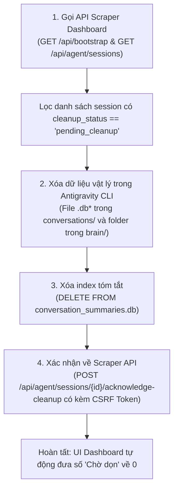

# Quy trình Dọn dẹp & Xóa Antigravity Conversations

Tài liệu này mô tả chi tiết cơ chế quản lý, vị trí lưu trữ và quy trình tự động dọn dẹp hàng loạt các conversation Antigravity đang ở trạng thái **"Chờ dọn" (`pending_cleanup`)** trong hệ thống WRYDECO Scraper.

---

## 1. Bối cảnh & Nguyên nhân phát sinh "Chờ dọn"

### 1.1. Cách Antigravity vận hành trong Scraper
- Mỗi vòng đời của Scraper Server (Flask) sẽ khởi tạo **1 conversation Control dài hạn** thông qua CLI `agy` để bootstrap và kiểm tra trạng thái MCP.
- Đối với mỗi sản phẩm cào dữ liệu từ Amazon, hệ thống sẽ spawn một **conversation Content độc lập** (được giới hạn bởi biến môi trường `WRYDECO_EXPECTED_TASK_ID`) để AI Agent viết nội dung SEO/AEO và phân tích hình ảnh gallery. Việc này nhằm đảm bảo nguyên tắc **cách ly tuyệt đối (zero context leak)** giữa các sản phẩm.
- Khi một server mới khởi động hoặc một phiên làm việc hoàn tất/thay thế, các conversation cũ thuộc quyền sở hữu của Scraper sẽ được đánh dấu trạng thái là `pending_cleanup` trong bảng `agent_sessions` của cơ sở dữ liệu `scraper/.runtime/orchestrator.sqlite3`.

### 1.2. Thách thức với quy trình thủ công trên UI
Giao diện Dashboard cung cấp popup **"Quản lý Antigravity Conversations"** với cảnh báo:
> *"Antigravity yêu cầu xác nhận xóa trong TUI: Bấm Copy ID, mở TUI rồi dán vào ô tìm kiếm, nhấn F4 để xóa và xác nhận. Chỉ nhấn Đã xóa trong Antigravity sau khi hoàn tất."*

Khi hệ thống cào nhiều đợt (hàng chục đến hàng trăm task), số lượng conversation tích lũy trong danh sách "Chờ dọn" tăng lên rất nhanh (ví dụ: 49 hay 67 conversations). Việc thực hiện thủ công từng conversation qua giao diện dòng lệnh (TUI) rất tốn thời gian. Do đó, quy trình tự động hóa dọn dẹp triệt để là giải pháp tối ưu.

---

## 2. Bản đồ vị trí lưu trữ dữ liệu (Data Storage Layout)

Dữ liệu của Antigravity và Scraper nằm ở hai hệ thống lưu trữ tách biệt:

### A. Hệ thống lưu trữ của Antigravity CLI (`agy`)
Nằm trong thư mục người dùng: `C:\Users\<USER>\.gemini\`

| Vị trí | Mục đích lưu trữ | Dữ liệu cần dọn |
| :--- | :--- | :--- |
| `antigravity-cli\conversations\` | Cơ sở dữ liệu SQLite lưu toàn bộ lịch sử turn, message, tool calls, token usage | Các file `<conversation_id>.db`, `<conversation_id>.db-wal`, `<conversation_id>.db-shm` |
| `antigravity-cli\brain\` | Thư mục workspace, scratchpad, trajectory logs của conversation | Thư mục mang tên `<conversation_id>` |
| `antigravity-cli\conversation_summaries.db` | SQLite database chứa bảng `conversation_summaries` phục vụ hiển thị danh sách khi gõ `/resume` trong CLI | Các dòng có `conversation_id = ?` |
| `antigravity\conversation_summaries.db` | SQLite database tóm tắt đồng bộ giữa CLI và Antigravity IDE | Các dòng có `conversation_id = ?` |

### B. Hệ thống lưu trữ của Scraper Project
Nằm trong workspace: `scraper/.runtime/orchestrator.sqlite3`

| Bảng dữ liệu | Mục đích | Cách xử lý |
| :--- | :--- | :--- |
| `agent_sessions` | Quản lý danh sách các session Antigravity thuộc scraper | Xóa dòng có `cleanup_status = 'pending_cleanup'` |
| `events` | Nhật ký sự kiện chi tiết của scraper (crawler, media, agent, shopify) | Xóa toàn bộ event có chứa `session_id` tương ứng |

---

## 3. Quy trình 4 bước dọn dẹp tự động (Automated Workflow)

Quy trình tự động thực hiện tuần tự và đảm bảo tính toàn vẹn dữ liệu:



### Bước 1: Lấy Token CSRF & Danh sách Session cần dọn
Scraper Server có cơ chế bảo vệ mutation requests (`guard_mutations`), yêu cầu header `X-CSRF-Token`.
1. Gửi request `GET http://127.0.0.1:5000/api/bootstrap` để lấy `csrf_token`.
2. Gửi request `GET http://127.0.0.1:5000/api/agent/sessions` để lấy toàn bộ session và lọc các session có `cleanup_status == 'pending_cleanup'`.
3. Lưu lại cặp `session_id` (ID trong scraper) và `conversation_id` (UUID của Antigravity).

### Bước 2: Xóa triệt để file vật lý của Antigravity
Với từng `conversation_id`:
1. Kiểm tra và xóa file database:
   - `~/.gemini/antigravity-cli/conversations/<conversation_id>.db`
   - `~/.gemini/antigravity-cli/conversations/<conversation_id>.db-wal` (nếu có)
   - `~/.gemini/antigravity-cli/conversations/<conversation_id>.db-shm` (nếu có)
   - Kiểm tra tương tự trong thư mục `~/.gemini/antigravity/conversations/`.
2. Xóa đệ quy thư mục artifacts/logs:
   - `~/.gemini/antigravity-cli/brain/<conversation_id>/`
   - `~/.gemini/antigravity/brain/<conversation_id>/`

### Bước 3: Dọn sạch danh mục tóm tắt (`conversation_summaries.db`)
Để Antigravity TUI không còn hiển thị các conversation đã xóa trong menu `/resume`:
1. Mở kết nối SQLite tới `~/.gemini/antigravity-cli/conversation_summaries.db`.
2. Mở kết nối SQLite tới `~/.gemini/antigravity/conversation_summaries.db`.
3. Thực thi câu lệnh:
   ```sql
   DELETE FROM conversation_summaries WHERE conversation_id = ?;
   ```
4. Commit giao dịch và đóng kết nối.

### Bước 4: Đồng bộ trạng thái về Scraper Backend
1. Với mỗi `session_id`, gửi request:
   - **Method**: `POST`
   - **URL**: `http://127.0.0.1:5000/api/agent/sessions/<session_id>/acknowledge-cleanup`
   - **Headers**:
     - `Content-Type: application/json`
     - `X-CSRF-Token: <csrf_token>`
   - **Body**: `{}`
2. Bên dưới tầng backend, hàm `acknowledge_agent_cleanup()` sẽ:
   - Xóa các bản ghi event liên quan trong bảng `events`.
   - Xóa session khỏi bảng `agent_sessions`.
   - Kích hoạt `self._condition.notify_all()` để các client SSE (Server-Sent Events) trên Dashboard nhận thông báo cập nhật ngay lập tức.

---

## 4. Nguyên tắc an toàn (Safety Guarantees)

1. **Bảo vệ Conversation đang hoạt động**:
   - Tuyệt đối không xóa các session có `cleanup_status == 'current'`.
   - Conversation Control đang kết nối (`ready` / `busy`) được bảo vệ nguyên vẹn 100%.
2. **Không xóa nhầm conversation cá nhân**:
   - Chỉ xóa các conversation ID được lưu và sở hữu bởi `agent_sessions` của scraper project.
3. **Fail-safe khi server tắt**:
   - Trong trường hợp server Dashboard không chạy, việc xóa file và bản ghi SQLite trong Antigravity vẫn an toàn, còn dữ liệu trong `orchestrator.sqlite3` có thể được dọn trực tiếp qua script Python nội bộ.

---

## 5. Script Python mẫu dùng để thực thi

Script dưới đây là công cụ tiêu chuẩn để chạy khi cần dọn dẹp hàng loạt:

```python
import json
import shutil
import sqlite3
import urllib.request
from pathlib import Path

def cleanup_antigravity_conversations(base_url: str = "http://127.0.0.1:5000"):
    # 1. Lấy CSRF token và danh sách session từ API
    with urllib.request.urlopen(f"{base_url}/api/bootstrap") as resp:
        csrf_token = json.loads(resp.read().decode("utf-8")).get("csrf_token")

    with urllib.request.urlopen(f"{base_url}/api/agent/sessions") as resp:
        sessions = json.loads(resp.read().decode("utf-8")).get("sessions", [])

    pending = [s for s in sessions if s.get("cleanup_status") == "pending_cleanup"]
    print(f"Phát hiện {len(pending)} conversations cần dọn dẹp.")
    if not pending:
        return

    # Đường dẫn lưu trữ của Antigravity
    cli_conv_dir = Path.home() / ".gemini" / "antigravity-cli" / "conversations"
    cli_brain_dir = Path.home() / ".gemini" / "antigravity-cli" / "brain"
    cli_sum_db = Path.home() / ".gemini" / "antigravity-cli" / "conversation_summaries.db"
    ide_sum_db = Path.home() / ".gemini" / "antigravity" / "conversation_summaries.db"

    cli_sum_conn = sqlite3.connect(cli_sum_db)
    ide_sum_conn = sqlite3.connect(ide_sum_db)

    deleted_files = 0
    deleted_dirs = 0
    acknowledged = 0

    for s in pending:
        session_id = s["id"]
        cid = s.get("conversation_id")

        if cid:
            # 2. Xóa file database của conversation
            for suffix in ["", "-wal", "-shm", ".pb"]:
                p = cli_conv_dir / f"{cid}.db{suffix}" if not suffix.startswith(".") else cli_conv_dir / f"{cid}{suffix}"
                if p.exists():
                    p.unlink()
                    deleted_files += 1

            # 3. Xóa thư mục brain
            bp = cli_brain_dir / cid
            if bp.is_dir():
                shutil.rmtree(bp)
                deleted_dirs += 1

            # 4. Xóa tóm tắt trong conversation_summaries.db
            cli_sum_conn.execute("DELETE FROM conversation_summaries WHERE conversation_id = ?", (cid,))
            ide_sum_conn.execute("DELETE FROM conversation_summaries WHERE conversation_id = ?", (cid,))

        # 5. Gửi acknowledge tới Scraper API
        ack_url = f"{base_url}/api/agent/sessions/{session_id}/acknowledge-cleanup"
        headers = {"Content-Type": "application/json", "X-CSRF-Token": csrf_token}
        req = urllib.request.Request(ack_url, data=b"{}", headers=headers, method="POST")
        try:
            with urllib.request.urlopen(req) as ack_resp:
                if json.loads(ack_resp.read().decode("utf-8")).get("deleted"):
                    acknowledged += 1
        except Exception as exc:
            print(f"Lỗi acknowledge {session_id}: {exc}")

    cli_sum_conn.commit()
    cli_sum_conn.close()
    ide_sum_conn.commit()
    ide_sum_conn.close()

    print(f"Hoàn tất: Đã xóa {deleted_files} files, {deleted_dirs} folders và xác nhận {acknowledged} sessions.")

if __name__ == "__main__":
    cleanup_antigravity_conversations()
```
